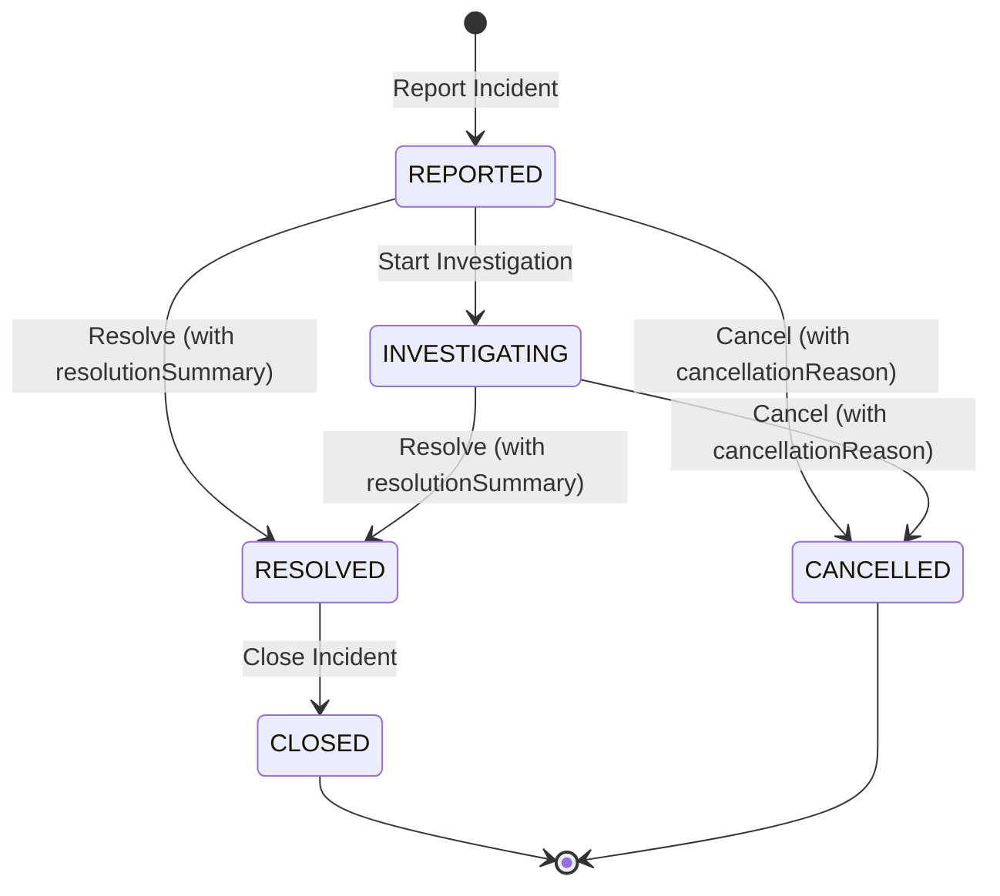

# Architecture: Incident Vertical Slice (Milestone 10)

## 1. Overview and Scope

Milestone 10 delivers the **Incident Vertical Slice** for the Vehicle Management System (VMS). This slice introduces authoritative incident reporting, status lifecycle transitions, dispatch gating, investigation notes threads, private MinIO evidence storage, and direct Maintenance Request escalation while maintaining modular monolith architecture, optimistic concurrency, and strict multi-tenant isolation.

### Scope Boundaries

- **In Scope (Milestone 10)**:
  - **Core Domain Entities & Value Objects**:
    - `Incident`: Authoritative record of fleet incidents (`REPORTED -> INVESTIGATING -> RESOLVED -> CLOSED | CANCELLED`). Tracks `displayId` (e.g. `INC-1001`), `type` (`ACCIDENT`, `BREAKDOWN`, `DAMAGE`, `TRAFFIC_VIOLATION`, `THEFT`, `HAZARD`, `SAFETY`, `OTHER`), `severity` (`LOW`, `MEDIUM`, `HIGH`, `CRITICAL`), `status`, `operationalImpact` (`NONE`, `VEHICLE`, `DRIVER`, `BOTH`), `title`, `description`, `occurredAt`, `location`, optional `vehicleId`, optional `driverId`, optional `tripId`, `reportedById`, `resolutionSummary`, `resolvedAt`, `resolvedById`, `closedAt`, `closedById`, `cancelReason`, `cancelledAt`, `cancelledById`, and `version`.
    - `IncidentStatusHistory`: Immutable append-only audit trail capturing every lifecycle change (`fromStatus`, `toStatus`, `reason`, `changedById`, `changedAt`).
    - `IncidentNote`: Chronological investigation notes thread allowing authorized team members to log notes and investigation updates (`incidentId`, `body`, `createdById`, `createdAt`).
    - `IncidentAttachment`: Private MinIO evidence attachments (`incidentId`, `attachmentType` [`PHOTO`, `POLICE_REPORT`, `ESTIMATE`, `DOCUMENT`, `OTHER`], `objectKey`, `fileName`, `fileSizeBytes`, `mimeType`, `fileHashSha256`, `caption`, `createdById`, `createdAt`).
  - **Operational Invariants & Core Protections**:
    - **Vehicle Lifecycle Invariant**: Vehicle lifecycle remains strictly `DRAFT -> ACTIVE -> RETIRED`. No custom incident or damage status mutations are applied directly to the Vehicle aggregate.
    - **Driver Lifecycle Invariant**: Driver lifecycle remains strictly `DRAFT -> ACTIVE -> SUSPENDED -> INACTIVE`. Incident creation does not automatically mutate the Driver status.
    - **Trip Lifecycle Invariant**: Trip lifecycle remains `DRAFT -> READY -> IN_PROGRESS -> COMPLETED | CANCELLED | ABORTED`. Incidents do not automatically cancel or abort in-progress trips. Trip completion (`COMPLETE`) and trip abortion (`ABORT`) are never blocked by incidents.
    - **Operational Incident Dispatch Gate**: Trips in `DRAFT` transitioning to `READY` or starting (`START`) re-evaluate active incidents via `OperationalIncidentGatePort` (`OPERATIONAL_INCIDENT_GATE`). Active incidents (`REPORTED` or `INVESTIGATING`) with operational impact `VEHICLE` or `BOTH` reject dispatch with `VEHICLE_BLOCKED_BY_INCIDENT` (HTTP 409). Active incidents with operational impact `DRIVER` or `BOTH` reject dispatch with `DRIVER_BLOCKED_BY_INCIDENT` (HTTP 409).
    - **Maintenance Integration**: Explicit, idempotent creation of a Maintenance Request from an Incident (`POST /api/v1/incidents/:incidentId/maintenance-request`). Guarded by database unique constraint `(organizationId, sourceIncidentId)` on `maintenance_requests`.
    - **Optimistic Concurrency Control**: Mutating actions on Incidents require matching `version`, incrementing on each state change. Stale updates return HTTP 409.
    - **Private Object Storage**: Evidence attachments are stored in private MinIO buckets under `tenants/{orgId}/incidents/{incidentId}/{attachmentId}/{filename}`. Magic-byte MIME verification and SHA-256 integrity verification prevent malicious file uploads. Presigned download URLs are time-limited (15 minutes) and require verified tenant credentials.
  - **Role-Based Access Control (RBAC)**:
    - 10 granular permissions: `incident.read`, `incident.create`, `incident.update`, `incident.investigate`, `incident.resolve`, `incident.close`, `incident.cancel`, `incident.note.create`, `incident.attachment.upload`, `incident.attachment.download`.
  - **Audit Logging & Transactional Outbox**:
    - Immutable audit logs for all mutations (incident creation, status transitions, note additions, attachment uploads, maintenance request escalations).
    - Transactional outbox events: `IncidentCreated`, `IncidentInvestigatingStarted`, `IncidentResolved`, `IncidentClosed`, `IncidentCancelled`, `IncidentMaintenanceRequested`.
  - **Responsive Web Portal**:
    - Incidents registry and filtering (`/incidents`).
    - Incident reporting form (`/incidents/new`).
    - Comprehensive Incident detail view (`/incidents/[id]`) with status action workflows (Start Investigation, Resolve Modal, Close, Cancel Modal), notes thread, evidence file upload & secure download, maintenance escalation card, and status history timeline.
    - Deep integrations on Vehicle detail (`/vehicles/[vehicleId]`), Driver detail (`/drivers/[driverId]`), and Trip detail (`/trips/[tripId]`).

- **Out of Scope (Preserved for Future Milestones)**:
  - Automated GPS breadcrumbs or telematics shock/crash detection.
  - SMS/Email notifications and webhook automation.
  - Third-party insurance claims processing or legal case management workflows.
  - Direct ledger accounts payable or payment processing.

---

## 2. Layered Architecture

The Incident slice adheres to the strict dependency direction of the modular monolith:

```text
HTTP Transport (IncidentController, VehicleIncidentsController, DriverIncidentsController, TripIncidentsController)
       │
       ▼
Application Use Cases & Ports (IncidentService, IIncidentRepository, OperationalIncidentGatePort, ObjectStoragePort)
       │
       ▼
Domain Entities & State Machine (Incident, IncidentStatusHistory, IncidentNote, IncidentAttachment, IncidentStateMachine)
       ▲
       │
Infrastructure Adapters (PrismaIncidentRepository, PrismaOperationalIncidentGateAdapter, S3ObjectStorageAdapter)
```

1. **Transport Layer**:
   - `IncidentController`: Incident creation, detail retrieval, pagination, status transitions (`investigate`, `resolve`, `close`, `cancel`), notes thread, attachment upload, and presigned download URL generation.
   - `VehicleIncidentsController`: Vehicle-scoped incident listing (`GET /api/v1/vehicles/:vehicleId/incidents`).
   - `DriverIncidentsController`: Driver-scoped incident listing (`GET /api/v1/drivers/:driverId/incidents`).
   - `TripIncidentsController`: Trip-scoped incident listing (`GET /api/v1/trips/:tripId/incidents`).
2. **Application Layer**:
   - `IncidentService`: Orchestrates domain aggregate mutations within database transactions, checks optimistic concurrency, records status transitions in `IncidentStatusHistory`, creates audit logs, and writes outbox events.
   - `IIncidentRepository`: Port defining persistence queries and transactional mutations.
   - `OperationalIncidentGatePort`: Port injected into `TripService` (`OPERATIONAL_INCIDENT_GATE`) to check whether a vehicle or driver is blocked by active incidents.
   - `ObjectStoragePort`: Port used to store private evidence attachments in MinIO and generate secure presigned download URLs.
3. **Domain Layer**:
   - `Incident`: Aggregate root enforcing lifecycle transitions, resolution summary requirements, cancel reason validation, and version bumping.
   - `IncidentStatusHistory`: Value object recording immutable audit of lifecycle changes.
   - `IncidentNote`: Value object recording notes added during investigation.
   - `IncidentAttachment`: Value object representing evidence metadata, magic byte validation, and SHA-256 hash.
   - `OperationalIncidentGate`: Pure domain rules evaluating whether an incident status and operational impact block vehicle or driver dispatch.
4. **Infrastructure Layer**:
   - `PrismaIncidentRepository`: PostgreSQL adapter implementing tenant isolation via composite tenant foreign keys `(vehicle_id, organization_id)`, `(driver_id, organization_id)`, and `(trip_id, organization_id)`.
   - `PrismaOperationalIncidentGateAdapter`: Evaluates active incidents directly against PostgreSQL using parameterized tenant queries.
   - `S3ObjectStorageAdapter`: Stores files in private MinIO/S3 buckets and issues 15-minute presigned download URLs.

---

## 3. Database Schema and Multi-Tenancy

Checked-in migration: `20261112000000_incident`.

Full chronological sequence verified from `packages/database/prisma/migrations`:

1. `20260818000000_foundation`
2. `20260818115052_identity_organization_foundation`
3. `20260919000000_vehicle`
4. `20260929000000_driver`
5. `20260929120000_assignment`
6. `20261019000000_trip`
7. `20261029000000_inspection`
8. `20261109000000_maintenance`
9. `20261110000000_compliance_documents`
10. `20261111000000_finance_fuel_expenses`
11. `20261111120000_finance_integrity`
12. `20261112000000_incident`

### Tables and Constraints

- **`incidents`**:
  - Primary Key: `id` (UUID).
  - Multi-tenant Foreign Key: `organization_id` -> `organizations(id)`.
  - Composite Unique Display ID: `(organization_id, display_id)`.
  - Composite Tenant Foreign Keys:
    - `(vehicle_id, organization_id)` -> `vehicles(id, organization_id)`
    - `(driver_id, organization_id)` -> `drivers(id, organization_id)`
    - `(trip_id, organization_id)` -> `trips(id, organization_id)`
  - Partial & Composite Indexes:
    - `(organization_id, status)` for dispatch gating and filtering.
    - `(organization_id, vehicle_id, status)` for vehicle operational status checks.
    - `(organization_id, driver_id, status)` for driver operational checks.
    - `(organization_id, trip_id)` for trip incident queries.
    - `(organization_id, occurred_at DESC)` for chronological listing.

- **`incident_status_history`**:
  - Primary Key: `id` (UUID).
  - Composite Tenant Foreign Key: `(incident_id, organization_id)` -> `incidents(id, organization_id)`.
  - Foreign Key: `actor_id` -> `users(id)`.

- **`incident_notes`**:
  - Primary Key: `id` (UUID).
  - Composite Tenant Foreign Key: `(incident_id, organization_id)` -> `incidents(id, organization_id)`.
  - Foreign Key: `created_by` -> `users(id)`.

- **`incident_attachments`**:
  - Primary Key: `id` (UUID).
  - Composite Tenant Foreign Key: `(incident_id, organization_id)` -> `incidents(id, organization_id)`.
  - Foreign Key: `created_by` -> `users(id)`.

- **`maintenance_requests` (Milestone 10 Addition)**:
  - Added nullable `source_incident_id` UUID column.
  - Added partial unique constraint `(organization_id, source_incident_id)` where `source_incident_id IS NOT NULL` to enforce strict 1:1 escalation idempotency.
  - Added composite foreign key `(source_incident_id, organization_id)` -> `incidents(id, organization_id)`.

---

## 4. State Machine and Lifecycle



### Transition Rules

1. `REPORTED -> INVESTIGATING`: Requires permission `incident.investigate`. Bumps version.
2. `REPORTED -> RESOLVED` / `INVESTIGATING -> RESOLVED`: Requires permission `incident.resolve` and non-empty `resolutionSummary` (minimum 3 characters). Sets `resolvedAt` and `resolvedById`.
3. `RESOLVED -> CLOSED`: Requires permission `incident.close`. Sets `closedAt` and `closedById`. Terminal status.
4. `REPORTED -> CANCELLED` / `INVESTIGATING -> CANCELLED`: Requires permission `incident.cancel` and non-empty `cancelReason` (minimum 3 characters). Sets `cancelledAt` and `cancelledById`. Terminal status.
5. `CLOSED` & `CANCELLED` are terminal: Any subsequent mutation or transition attempt throws `IncidentAlreadyClosedError` / `IncidentAlreadyCancelledError` (HTTP 409).

---

## 5. Operational Dispatch Gating

The operational dispatch gate protects fleet safety by preventing vehicles and drivers with active, unresolved incidents from being dispatched on trips:

```text
Trip in DRAFT -> Mark Ready (READY)
                     │
                     ▼
         OperationalIncidentGatePort
                     │
    ┌────────────────┴────────────────┐
    ▼                                 ▼
Active Incident for Vehicle?     Active Incident for Driver?
(impact in VEHICLE, BOTH)       (impact in DRIVER, BOTH)
    │                                 │
   YES                               YES
    ▼                                 ▼
Throw 409                         Throw 409
VEHICLE_BLOCKED_BY_INCIDENT       DRIVER_BLOCKED_BY_INCIDENT
```

- **Blocking Statuses**: `REPORTED` and `INVESTIGATING`.
- **Non-blocking Statuses**: `RESOLVED`, `CLOSED`, and `CANCELLED`.
- **Exempt Trip Operations**: Trip `COMPLETE` and `ABORT` are never blocked by incidents. In-flight trips can always be completed or aborted even if an incident is reported mid-trip.

---

## 6. Security and Evidence Object Storage

1. **Storage Topology**:
   - Files are stored in private MinIO/S3 object storage under tenant-isolated paths:
     `tenants/{orgId}/incidents/{incidentId}/{attachmentId}/{filename}`.
   - S3 bucket access is private; direct public URLs are never exposed.
2. **File Validation & Integrity**:
   - Supported MIME types: `image/jpeg`, `image/png`, `image/webp`, `application/pdf`.
   - Magic byte inspection validates actual file content matches declared MIME type.
   - SHA-256 cryptographic hash is calculated and stored with attachment metadata.
3. **Presigned Download URLs**:
   - Downloads are served exclusively through `GET /api/v1/incidents/:id/attachments/:attachmentId/download`.
   - Requires verified tenant authorization and permission `incident.attachment.download`.
   - Generates temporary (15-minute expiration) presigned URLs.

---

## 7. Role-Based Access Control (RBAC)

| Permission                     | Description                                   | Admin | Manager | Viewer |
| ------------------------------ | --------------------------------------------- | :---: | :-----: | :----: |
| `incident.read`                | View incidents, details, and attachments list |  Yes  |   Yes   |  Yes   |
| `incident.create`              | Report new incidents                          |  Yes  |   Yes   |   No   |
| `incident.update`              | Update incident metadata                      |  Yes  |   Yes   |   No   |
| `incident.investigate`         | Transition status to INVESTIGATING            |  Yes  |   Yes   |   No   |
| `incident.resolve`             | Transition status to RESOLVED                 |  Yes  |   Yes   |   No   |
| `incident.close`               | Transition status to CLOSED                   |  Yes  |   Yes   |   No   |
| `incident.cancel`              | Transition status to CANCELLED                |  Yes  |   Yes   |   No   |
| `incident.note.create`         | Add investigation notes                       |  Yes  |   Yes   |   No   |
| `incident.attachment.upload`   | Upload evidence files                         |  Yes  |   Yes   |   No   |
| `incident.attachment.download` | Generate download URL for evidence            |  Yes  |   Yes   |  Yes   |

---

## 8. Audit Logging & Transactional Outbox

Every state mutation in the Incident slice produces both an immutable audit log entry in `audit_logs` and a transactional outbox message in `outbox_events` within the same database transaction:

- **Outbox Event Types**:
  - `IncidentCreated`
  - `IncidentInvestigatingStarted`
  - `IncidentResolved`
  - `IncidentClosed`
  - `IncidentCancelled`
  - `IncidentMaintenanceRequested`
- **Worker Processing**:
  - Outbox events are polled by `@vms/worker` and dispatched via `LoggingEventPublisher`.
  - Delivery attempts are tracked with exponential retry logic.
