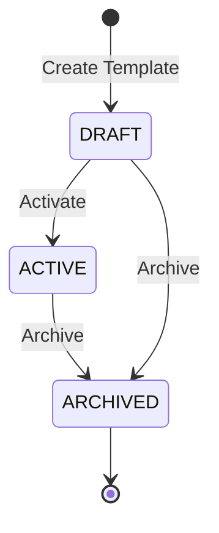
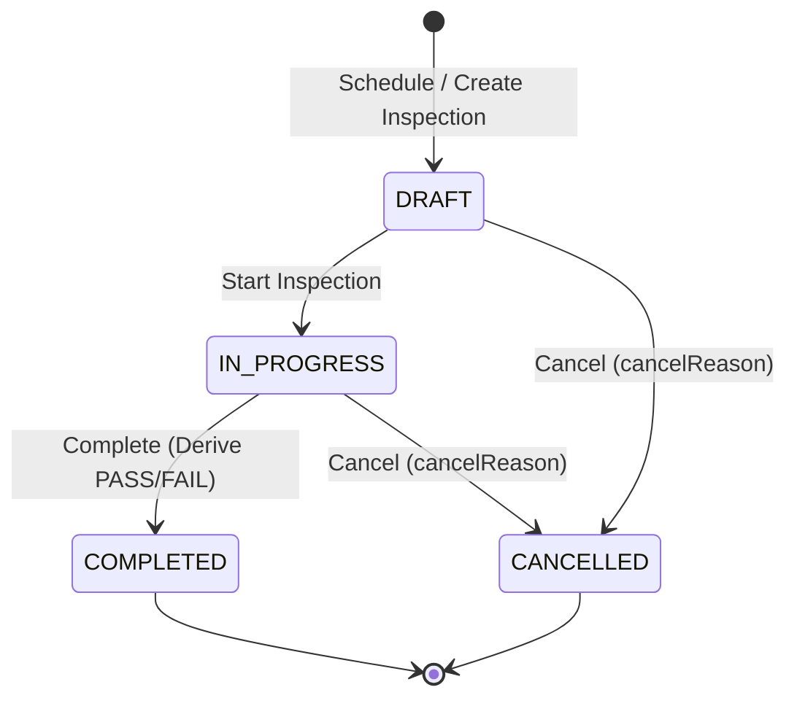

# Architecture: Inspection Slice (Milestone 6)

## 1. Overview and Scope

Milestone 6 delivers the **Inspection Vertical Slice** of the Vehicle Management System (VMS). Inspections provide formal digital vehicle condition verification (Driver Vehicle Inspection Reporting / DVIR) integrated directly into operational fleet workflows.

### Scope Boundaries

- **In Scope (Milestone 6)**:
  - **Inspection Template Aggregate**: Reusable checklist schemas with lifecycle `DRAFT -> ACTIVE -> ARCHIVED`.
  - **Checklist Items**: Configurable order, title, description, category (`TIRES`, `BRAKES`, `LIGHTS`, `FLUIDS`, `BODY`, `INTERIOR`, `SAFETY`, `OTHER`), criticality (`is_critical`), and optional requirement (`is_required`).
  - **Template Immutability**: Active and Archived templates strictly forbid item mutations or schema modifications (`TEMPLATE_IMMUTABLE` 400 Bad Request).
  - **Inspection Aggregate**: Execution lifecycle `DRAFT -> IN_PROGRESS -> COMPLETED / CANCELLED`.
  - **Inspection Types**: `PRE_TRIP`, `POST_TRIP`, and `ROUTINE`.
  - **Checklist Item Responses**: Recorded as `PASS`, `FAIL`, or `NOT_APPLICABLE` with optional defect remarks.
  - **Deterministic Result Derivation**:
    - `PASS`: 0 item failures.
    - `FAIL`: >= 1 item failure.
    - `hasCriticalFailure`: Flagged `true` if any failed item has `isCritical = true`.
  - **Pre-Trip Operational Gate on Trips**:
    - Trip `START` (`READY -> IN_PROGRESS`) requires an associated `PRE_TRIP` inspection in `COMPLETED` status with result `PASS`.
    - Missing inspection blocks departure with 409 Conflict (`PRE_TRIP_INSPECTION_REQUIRED`).
    - Failed inspection blocks departure with 409 Conflict (`PRE_TRIP_INSPECTION_FAILED`).
  - **Post-Trip Operational Gate on Trips**:
    - Trip `COMPLETE` (`IN_PROGRESS -> COMPLETED`) requires an associated `POST_TRIP` inspection in `COMPLETED` status.
    - Missing post-trip inspection blocks completion with 409 Conflict (`POST_TRIP_INSPECTION_REQUIRED`).
    - Post-trip completion is allowed regardless of `PASS` or `FAIL` result to enable logging defects discovered during journey without stranding vehicle operations.
  - **Trip Abort and Cancel Ungated**:
    - Trip cancellation (from `DRAFT` or `READY`) and trip abort (from `IN_PROGRESS`) remain completely ungated by inspections.
  - **Vehicle and Driver Lifecycle Decoupling**:
    - Inspection results and critical defects NEVER mutate `Vehicle.status` (`ACTIVE`) or `Driver.status` (`ACTIVE`).
  - **Optimistic Concurrency Control**:
    - Integer `version` column on both Templates and Inspections, rejecting concurrent updates with 409 Conflict (`CONCURRENCY_CONFLICT`).
  - **Role-Based Access Control (RBAC)**:
    - 8 dedicated inspection permissions (`inspection.template.read`, `inspection.template.create`, `inspection.template.update`, `inspection.template.archive`, `inspection.read`, `inspection.create`, `inspection.execute`, `inspection.cancel`).
  - **Transactional Outbox Events**:
    - Atomically published events: `InspectionCreated`, `InspectionCompleted`, `InspectionFailed`, `InspectionCriticalFailureDetected`, `InspectionCancelled`.
  - **Immutable Audit Logging**:
    - Every inspection creation, lifecycle transition, and response update is logged to `audit_logs` with authenticated principal context.
  - **Web UI & Fleet Integrations**:
    - Responsive Next.js UI for managing templates and conducting inspections with interactive checklists, filterable list views, and historical inspection timelines integrated directly into Vehicle, Driver, and Trip details pages.
- **Out of Scope (Milestone 7+)**:
  - Maintenance service schedules, preventative maintenance intervals, repair requests, and work orders.
  - Mechanics, external service vendors, parts inventories, and labor cost accounting.
  - Fuel logging and toll/expense receipts.
  - Accident, collision, and insurance claims management.
  - GPS, telemetry streaming, sensor alarms, and live map geofencing.

---

## 2. Layered Architecture

The Inspection slice adheres strictly to the repository's modular-monolith dependency rules:

```text
HTTP Transport (InspectionController, InspectionTemplateController, Nested Vehicle/Trip/Driver Controllers)
       │
       ▼
Application Use Cases & Repository Ports (InspectionRepository, InspectionTemplateRepository, TripInspectionGate)
       │
       ▼
Domain Rules & Validation Policies (Inspection, InspectionTemplate, Checklist Items, Result Derivation)
       ▲
       │
Infrastructure Adapters (PrismaInspectionRepository, PrismaTripRepository, PostgreSQL)
```

- **Domain Model (`apps/api/src/modules/inspection/domain/`)**:
  - `inspection-template.ts`: Domain models, item category enums, and transition rules (`DRAFT -> ACTIVE -> ARCHIVED`).
  - `inspection.ts`: Execution state machine, response recording, automatic `PASS`/`FAIL` outcome calculation, and critical failure detection.
  - Zero dependencies on NestJS, Prisma, PostgreSQL, or web frameworks.
- **Application Layer (`apps/api/src/modules/inspection/application/`)**:
  - Defines repository ports `InspectionRepository` and `InspectionTemplateRepository`.
  - Implements application services coordinating transactions, cross-entity validation, audit entries, and outbox event publishing.
  - `TripInspectionGate` port consumed by `PrismaTripRepository` during Trip `START` and `COMPLETE` operations.
- **Infrastructure Layer (`apps/api/src/modules/inspection/infrastructure/`)**:
  - `PrismaInspectionRepository`: Manages database transactions, composite foreign keys, and atomic response updates.
  - `PrismaTripRepository`: Invokes pre-trip and post-trip inspection verification queries inside transactional boundaries.
- **Transport Layer (`apps/api/src/modules/inspection/transport/`)**:
  - `InspectionTemplateController` and `InspectionController`.
  - Nested resource controllers for `/api/v1/vehicles/:vehicleId/inspections`, `/api/v1/trips/:tripId/inspections`, and `/api/v1/drivers/:driverId/inspections`.
  - Strict input validation via `class-validator` DTOs and security via `@TenantScoped()` and `@RequirePermissions()`.

---

## 3. Database Schema and Constraints

The database schema is defined in Prisma migration `20261029000000_inspection` and introduces four tables:

```sql
-- Inspection Templates
CREATE TABLE inspection_templates (
    id UUID NOT NULL DEFAULT gen_random_uuid(),
    organization_id UUID NOT NULL,
    display_id VARCHAR(40) NOT NULL,
    name VARCHAR(200) NOT NULL,
    description VARCHAR(500),
    type "InspectionType" NOT NULL,
    status "InspectionTemplateStatus" NOT NULL DEFAULT 'DRAFT',
    version INTEGER NOT NULL DEFAULT 1,
    created_at TIMESTAMPTZ(3) NOT NULL DEFAULT CURRENT_TIMESTAMP,
    created_by UUID NOT NULL,
    updated_at TIMESTAMPTZ(3) NOT NULL,
    updated_by UUID NOT NULL,
    CONSTRAINT inspection_templates_pkey PRIMARY KEY (id)
);

-- Template Checklist Items
CREATE TABLE inspection_template_items (
    id UUID NOT NULL DEFAULT gen_random_uuid(),
    template_id UUID NOT NULL,
    order_index INTEGER NOT NULL,
    title VARCHAR(200) NOT NULL,
    description VARCHAR(500),
    category "InspectionItemCategory" NOT NULL,
    is_critical BOOLEAN NOT NULL DEFAULT false,
    is_required BOOLEAN NOT NULL DEFAULT true,
    CONSTRAINT inspection_template_items_pkey PRIMARY KEY (id),
    CONSTRAINT inspection_template_items_template_id_order_index_key UNIQUE (template_id, order_index)
);

-- Inspections
CREATE TABLE inspections (
    id UUID NOT NULL DEFAULT gen_random_uuid(),
    organization_id UUID NOT NULL,
    display_id VARCHAR(40) NOT NULL,
    template_id UUID NOT NULL,
    vehicle_id UUID NOT NULL,
    driver_id UUID,
    trip_id UUID,
    assignment_id UUID,
    type "InspectionType" NOT NULL,
    status "InspectionStatus" NOT NULL DEFAULT 'DRAFT',
    result "InspectionResult",
    has_critical_failure BOOLEAN NOT NULL DEFAULT false,
    odometer_km INTEGER,
    remarks VARCHAR(1000),
    cancel_reason VARCHAR(500),
    started_at TIMESTAMPTZ(3),
    completed_at TIMESTAMPTZ(3),
    version INTEGER NOT NULL DEFAULT 1,
    created_at TIMESTAMPTZ(3) NOT NULL DEFAULT CURRENT_TIMESTAMP,
    created_by UUID NOT NULL,
    updated_at TIMESTAMPTZ(3) NOT NULL,
    updated_by UUID NOT NULL,
    CONSTRAINT inspections_pkey PRIMARY KEY (id)
);

-- Inspection Checklist Item Responses
CREATE TABLE inspection_responses (
    id UUID NOT NULL DEFAULT gen_random_uuid(),
    inspection_id UUID NOT NULL,
    item_id UUID NOT NULL,
    result "InspectionItemResult" NOT NULL,
    remarks VARCHAR(500),
    created_at TIMESTAMPTZ(3) NOT NULL DEFAULT CURRENT_TIMESTAMP,
    updated_at TIMESTAMPTZ(3) NOT NULL,
    CONSTRAINT inspection_responses_pkey PRIMARY KEY (id),
    CONSTRAINT inspection_responses_inspection_id_item_id_key UNIQUE (inspection_id, item_id)
);
```

### Engine-Level Integrity Guarantees

1. **Composite Tenant-Scoped Foreign Keys**:
   - `inspections(template_id, organization_id) -> inspection_templates(id, organization_id)`
   - `inspections(vehicle_id, organization_id) -> vehicles(id, organization_id)`
   - `inspections(driver_id, organization_id) -> drivers(id, organization_id)` (nullable)
   - `inspections(trip_id, organization_id) -> trips(id, organization_id)` (nullable)
   - `inspections(assignment_id, organization_id) -> vehicle_driver_assignments(id, organization_id)` (nullable)
2. **Cascading Child Integrity**:
   - `inspection_template_items(template_id) -> inspection_templates(id)` with `ON DELETE CASCADE`.
   - `inspection_responses(inspection_id) -> inspections(id)` with `ON DELETE CASCADE`.
   - `inspection_responses(item_id) -> inspection_template_items(id)` with `ON DELETE RESTRICT`.
3. **Sequential Display Identifiers**:
   - Templates format: `TMPL-1001`, `TMPL-1002`, ...
   - Inspections format: `INSP-1001`, `INSP-1002`, ...
   - Generated atomically per tenant within database transactions.

---

## 4. State Machines

### Template Lifecycle



- **DRAFT**: Items can be added, updated, reordered, and removed.
- **ACTIVE**: Ready for use in inspections. Items are strictly frozen and immutable.
- **ARCHIVED**: Deprecated template. Cannot be used for creating new inspections. Items remain permanently immutable.

### Inspection Lifecycle



- **DRAFT**: Created with associated Vehicle, optional Driver/Trip, and active Template.
- **IN_PROGRESS**: Active checklist execution. Odometer recorded; item responses saved.
- **COMPLETED**: All required items evaluated. Result evaluated automatically as `PASS` or `FAIL`. Critical failures flagged.
- **CANCELLED**: Aborted inspection with mandatory `cancelReason`. Cannot be re-opened.

---

## 5. Pre-Trip and Post-Trip Operational Gates

### Pre-Trip Gate on Trip START

When an operator or driver attempts to start a trip (`POST /trips/:id/start`):

1. The trip must be in `READY` status.
2. The system queries for inspections matching:
   - `tripId === trip.id`
   - `type === 'PRE_TRIP'`
   - `status === 'COMPLETED'`
3. If no matching inspection exists:
   - Request is rejected with **409 Conflict**: `PRE_TRIP_INSPECTION_REQUIRED`.
4. If a matching completed inspection exists, but its `result !== 'PASS'`:
   - Request is rejected with **409 Conflict**: `PRE_TRIP_INSPECTION_FAILED`.
5. Only when a completed inspection with `result === 'PASS'` exists is the trip transitioned to `IN_PROGRESS`.

### Post-Trip Gate on Trip COMPLETE

When an operator or driver completes a journey (`POST /trips/:id/complete`):

1. The trip must be in `IN_PROGRESS` status.
2. The system queries for inspections matching:
   - `tripId === trip.id`
   - `type === 'POST_TRIP'`
   - `status === 'COMPLETED'`
3. If no matching completed post-trip inspection exists:
   - Request is rejected with **409 Conflict**: `POST_TRIP_INSPECTION_REQUIRED`.
4. The inspection result is **not** required to be `PASS`. Any defects recorded during the post-trip inspection are safely logged for maintenance triage without preventing trip completion.

---

## 6. Transactional Outbox Events

All inspection mutations write an outbox record inside the primary PostgreSQL transaction:

| Event Name                          | Aggregate Type | Payload Summary                                                         |
| :---------------------------------- | :------------- | :---------------------------------------------------------------------- |
| `InspectionCreated`                 | `Inspection`   | `id`, `displayId`, `type`, `vehicleId`, `driverId`, `tripId`            |
| `InspectionCompleted`               | `Inspection`   | `id`, `result`, `hasCriticalFailure`, `vehicleId`, `driverId`, `tripId` |
| `InspectionFailed`                  | `Inspection`   | `id`, `result: 'FAIL'`, `hasCriticalFailure`, `failedItemsCount`        |
| `InspectionCriticalFailureDetected` | `Inspection`   | `id`, `criticalItemIds`, `vehicleId`                                    |
| `InspectionCancelled`               | `Inspection`   | `id`, `cancelReason`                                                    |

The worker process polls, leases, and delivers these events with at-least-once delivery guarantees.

---

## 7. Security and Permissions

Every endpoint is secured with organization context and evaluated against active user permissions:

- `inspection.template.read`: View templates and checklist items.
- `inspection.template.create`: Create new draft templates.
- `inspection.template.update`: Update draft template metadata and checklist items.
- `inspection.template.archive`: Archive active or draft templates.
- `inspection.read`: List and view inspections and recorded responses.
- `inspection.create`: Schedule/create draft inspections.
- `inspection.execute`: Start inspection, save item responses, and complete inspection.
- `inspection.cancel`: Cancel an inspection in draft or in-progress status.
