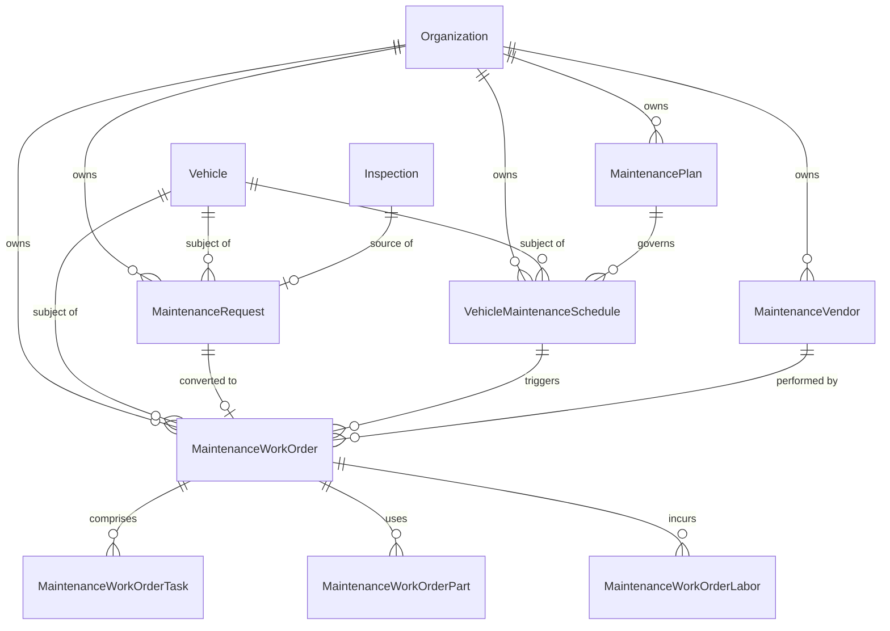

# Architecture: Maintenance Slice (Milestone 7)

## 1. Overview and Scope

Milestone 7 delivers the **Maintenance Vertical Slice** of the Vehicle Management System (VMS). Maintenance governs defect escalations, preventive maintenance schedules, vendor partnerships, and end-to-end work order executions with itemized parts, labor, and deterministic cost tracking.

### Scope Boundaries

- **In Scope (Milestone 7)**:
  - **Core Domain Entities & Aggregates**:
    - `MaintenanceRequest`: Ad-hoc or inspection-escalated defect reports (`DRAFT -> OPEN -> CONVERTED / REJECTED / CANCELLED`).
    - `MaintenanceVendor`: External maintenance providers (`ACTIVE / INACTIVE`).
    - `MaintenancePlan`: Preventive service schedules (`DRAFT -> ACTIVE -> ARCHIVED`) with time-based (`intervalDays`) and mileage-based (`intervalOdometerKm`) triggers.
    - `VehicleMaintenanceSchedule`: Per-vehicle plan enrollment tracking authoritative due states (`UPCOMING`, `DUE`, `OVERDUE`).
    - `MaintenanceWorkOrder`: Execution aggregate (`DRAFT -> OPEN -> IN_PROGRESS -> COMPLETED / CANCELLED`) with tasks checklist, parts ledger, labor hours/rates, and deterministic totals calculation.
  - **Operational Blocking Invariant**:
    - Vehicle status remains strictly decoupled: `DRAFT -> ACTIVE -> RETIRED`.
    - Maintenance NEVER introduces synthetic statuses like `MAINTENANCE` or `OUT_OF_SERVICE` to `Vehicle.status`.
    - Operational availability is derived dynamically: `isOperationallyAvailable` / `isVehicleOperationallyBlocked`.
    - A vehicle is blocked when it has at least one active, blocking maintenance request (`blocksOperation = true`, status `OPEN`) or work order (`blocksOperation = true`, status `OPEN` or `IN_PROGRESS`).
  - **Inspection Escalation via Transactional Outbox**:
    - When `InspectionCriticalFailureDetected` integration event is published, the worker idempotently generates a `CRITICAL`, operationally blocking Maintenance Request.
  - **Trip Maintenance Gate**:
    - Trip `READY` and `START` operations reject dispatch with `409 Conflict` (`VEHICLE_BLOCKED_BY_MAINTENANCE`) if the assigned vehicle is operationally blocked.
    - In-progress trips remain completeable (`COMPLETED` and `ABORTED` are never blocked by maintenance).
    - Existing Vehicle-Driver assignments remain intact (assignments are not automatically ended).
  - **Role-Based Access Control (RBAC)**:
    - 10 granular permissions: `maintenance.request.create`, `maintenance.request.read`, `maintenance.request.update`, `maintenance.plan.manage`, `maintenance.plan.read`, `maintenance.work_order.create`, `maintenance.work_order.read`, `maintenance.work_order.update`, `maintenance.vendor.manage`, `maintenance.vendor.read`.
  - **Optimistic Concurrency Control**:
    - Integer `version` column across requests, plans, schedules, vendors, and work orders, rejecting concurrent mutations with `409 CONCURRENCY_CONFLICT`.
  - **Transactional Outbox Events**:
    - Integration events: `MaintenanceRequestCreated`, `MaintenanceRequestStatusChanged`, `MaintenancePlanCreated`, `MaintenancePlanStatusChanged`, `MaintenanceWorkOrderCreated`, `MaintenanceWorkOrderStatusChanged`, `MaintenanceWorkOrderCompleted`.
  - **Immutable Audit Logging**:
    - Every state transition, schedule attachment, vendor creation, task status change, and cost calculation is recorded in `audit_logs`.
  - **Responsive Web UI**:
    - Dedicated `/maintenance` portal (dashboard, requests, work orders, plans, schedules, vendors).
    - Deep fleet integrations on Vehicle detail (operational readiness badge, assigned plans, blocking alert), Trip detail (maintenance gate blocking banner), and Inspection detail (create maintenance request escalation button).
- **Out of Scope (Preserved for Future Milestones)**:
  - Fuel transactions, fuel cards, charging receipts, expense ledger, and accounting integrations.
  - Insurance policies, damage claims, and collision investigations.
  - Real-time GPS, IoT telemetry, engine diagnostic trouble codes (DTC), and geofencing.
  - Parts inventory warehouse management, purchase orders, and supplier procurement.
  - Payroll, employee timesheets, and driver compensation.

---

## 2. Layered Architecture

The Maintenance slice adheres strictly to the repository's modular-monolith dependency rules:

```text
HTTP Transport (MaintenanceController, VehicleMaintenanceSchedulesController, InspectionMaintenanceController)
       │
       ▼
Application Use Cases & Ports (MaintenanceService, MaintenanceRepository, TripMaintenanceGate)
       │
       ▼
Domain Aggregates & Invariants (MaintenanceRequest, MaintenanceWorkOrder, MaintenancePlan, Schedule, Vendor)
       ▲
       │
Infrastructure Adapters (PrismaMaintenanceRepository, PrismaTripMaintenanceGateAdapter)
```

1. **Domain Layer (`apps/api/src/modules/maintenance/domain/`)**:
   - Pure TypeScript, zero external framework dependencies (no NestJS, Prisma, Express, or Redis).
   - Contains lifecycle state machines (`assertValidRequestTransition`, `assertValidWorkOrderTransition`, `assertValidPlanTransition`).
   - Implements mathematical cost formulas (`calculateWorkOrderTotals`: `partsTotal + laborTotal = totalCost`).
   - Computes schedule due states (`deriveScheduleDueState`: `UPCOMING`, `DUE`, `OVERDUE`).
2. **Application Layer (`apps/api/src/modules/maintenance/application/`)**:
   - Contains ports: `MaintenanceRepository`, `TripMaintenanceGate`.
   - `MaintenanceService` orchestrates business use cases, transactional boundaries, audit logging, and outbox event dispatching.
3. **Infrastructure Layer (`apps/api/src/modules/maintenance/infrastructure/`)**:
   - `PrismaMaintenanceRepository`: Executes PostgreSQL transactional queries using Prisma client with tenant isolation (`organizationId`).
   - `PrismaTripMaintenanceGateAdapter`: Implements `TripMaintenanceGate` to query open blocking requests and in-progress work orders for trips.
4. **Transport Layer (`apps/api/src/modules/maintenance/transport/`)**:
   - REST API controllers with Swagger OpenAPI documentation, request validation DTOs (using class-validator), and permission guards.

---

## 3. Database Schema and Multi-Tenancy

Dedicated checked-in migration: `packages/database/prisma/migrations/20261109000000_maintenance/migration.sql`.

### Relational Schema



### Tenant Safety Invariants

- Every table contains `organization_id UUID NOT NULL` referencing `organizations(id)`.
- All foreign keys enforce tenant pairing (`[vehicle_id, organization_id]`, `[vendor_id, organization_id]`, etc.).
- Composite primary and unique constraints prevent cross-tenant data leakage.

---

## 4. Verification and Release Gate Results

All backend and frontend release gates have passed:

- **Format**: `pnpm format:check` — clean, 0 style issues.
- **Lint**: `pnpm lint` — clean, 0 warnings, 0 errors.
- **Typecheck**: `pnpm typecheck` — 10/10 workspace packages clean.
- **Unit & Integration Tests**: `pnpm test` — 204/204 API tests green, 12/12 worker tests green.
- **Build**: `pnpm build` — entire monorepo compiled with Turbopack and tsc.
- **Playwright Browser E2E**: `pnpm test:e2e` — 19/19 tests green across Assignment, Driver, Foundation, Inspection, Maintenance, Trip, and Vehicle.
- **Database Migrations**: `prisma migrate status` — 8 checked-in migrations up to date.
- **Git Check**: `git diff --check` — clean whitespace.
