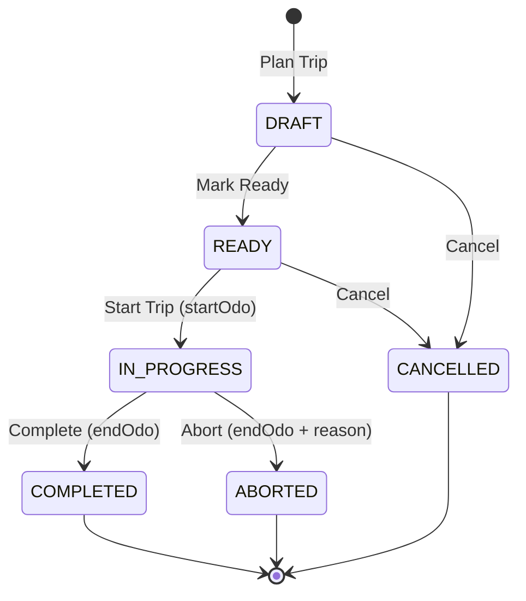

# Architecture: Trip Slice (Milestone 5)

## 1. Overview and Scope

Milestone 5 delivers the **Trip Vertical Slice** of the Vehicle Management System (VMS). Building upon the administrative pairing established in Milestone 4 (Vehicle-Driver Assignment), the Trip slice manages the operational execution lifecycle of physical journeys undertaken by assigned vehicles and drivers.

### Scope Boundaries

- **In Scope (Milestone 5)**:
  - Persistent Trip aggregate (`trips`) linked to `(assignment_id, organization_id, vehicle_id, driver_id)`.
  - Trip lifecycle state machine: `DRAFT -> READY -> IN_PROGRESS -> COMPLETED / CANCELLED / ABORTED`.
  - Immutable status history timeline (`trip_status_history`).
  - Single in-progress trip constraint per vehicle and per driver enforced via partial unique indexes in PostgreSQL.
  - Operational eligibility revalidation at `READY` and `START`:
    - Vehicle must be in `ACTIVE` status.
    - Driver must be in `ACTIVE` status and operationally eligible (holding at least one valid, unexpired qualifying license).
  - Safe in-flight closure: Driver suspension or license expiry while a trip is `IN_PROGRESS` does not prevent completing or aborting the trip.
  - Cross-aggregate Assignment guard: An assignment cannot be ended while any non-terminal trip (`DRAFT`, `READY`, `IN_PROGRESS`) exists (`ASSIGNMENT_HAS_ACTIVE_TRIP` 409 Conflict).
  - Odometer accounting and authoritative progression:
    - `startOdometerKm >= vehicle.odometerKm`
    - `endOdometerKm >= startOdometerKm`
    - Atomic progression of Vehicle's authoritative `odometerKm` on `COMPLETED` and `ABORTED`.
    - No odometer modification on `CANCELLED`.
  - Optimistic concurrency control via integer `version` field (`CONCURRENCY_CONFLICT` 409 Conflict).
  - Role-based access control with 9 dedicated trip permission codes (`trip.read`, `trip.create`, `trip.update`, `trip.ready`, `trip.start`, `trip.complete`, `trip.cancel`, `trip.abort`, `trip.history.read`).
  - Transactional outbox events for all mutations (`TripCreated`, `TripReady`, `TripStarted`, `TripCompleted`, `TripCancelled`, `TripAborted`).
  - Immutable audit logging for all trip operations.
  - Full Next.js Web UI for listing, filtering, creating, executing, completing, cancelling, and aborting trips, with integrations in Vehicle, Driver, and Assignment pages.
  - Comprehensive unit, API integration, worker, and Playwright browser E2E test suites.
- **Out of Scope (Milestone 6+)**:
  - Vehicle inspections and pre/post-trip DVIR forms.
  - Maintenance service intervals and work orders.
  - Fuel logging and expense tracking.
  - Incident/collision logging.
  - GPS, telemetry streams, real-time live map tracking, and geofencing.

---

## 2. Layered Architecture

The Trip vertical slice adheres strictly to the modular monolith dependency direction:

```text
HTTP Transport (TripController, VehicleTripController, DriverTripController, AssignmentTripController, DTOs)
       │
       ▼
Application Use Cases & Repository Ports (TripRepository, TripService)
       │
       ▼
Domain Rules & Validation Policies (Trip, TripStatus, State Transitions, Odometer Rules)
       ▲
       │
Infrastructure Adapters (PrismaTripRepository, PostgreSQL)
```

- **Domain Model (`apps/api/src/modules/trip/domain/trip.ts`)**: Pure TypeScript functions and types with zero framework dependencies. Encapsulates state machine transitions, odometer progression invariants, distance calculation, planning window validation, and operational eligibility assertion.
- **Application Layer (`apps/api/src/modules/trip/application/`)**: Defines `TripRepository` port interface and `TripService`. Coordinates interactive database transactions, optimistic locking checks, cross-aggregate verification, outbox event generation, and audit logging.
- **Infrastructure Layer (`apps/api/src/modules/trip/infrastructure/prisma-trip.repository.ts`)**: Implements `TripRepository` using Prisma Client inside interactive database transactions (`database.$transaction`). Enforces trusted tenant filtering on all queries and mutations.
- **Transport Layer (`apps/api/src/modules/trip/transport/`)**: Four REST controllers (`TripController`, `VehicleTripController`, `DriverTripController`, `AssignmentTripController`) with `@TenantScoped()`, `@RequirePermissions()`, and strict class-validator DTOs.

---

## 3. Database Schema and Constraints

The persistent schema is codified in Prisma migration `20261019000000_trip` and creates the `trips` and `trip_status_history` tables:

```sql
CREATE TABLE trips (
    id UUID NOT NULL DEFAULT gen_random_uuid(),
    organization_id UUID NOT NULL,
    display_id VARCHAR(40) NOT NULL,
    assignment_id UUID NOT NULL,
    vehicle_id UUID NOT NULL,
    driver_id UUID NOT NULL,
    status "TripStatus" NOT NULL DEFAULT 'DRAFT',
    origin VARCHAR(200) NOT NULL,
    destination VARCHAR(200) NOT NULL,
    purpose VARCHAR(500),
    planned_start_at TIMESTAMPTZ(3),
    planned_end_at TIMESTAMPTZ(3),
    actual_start_at TIMESTAMPTZ(3),
    actual_end_at TIMESTAMPTZ(3),
    start_odometer_km INTEGER,
    end_odometer_km INTEGER,
    distance_km INTEGER,
    cancel_reason VARCHAR(500),
    abort_reason VARCHAR(500),
    notes VARCHAR(500),
    version INTEGER NOT NULL DEFAULT 1,
    created_at TIMESTAMPTZ(3) NOT NULL DEFAULT CURRENT_TIMESTAMP,
    created_by UUID NOT NULL,
    updated_at TIMESTAMPTZ(3) NOT NULL,
    updated_by UUID NOT NULL,
    CONSTRAINT trips_pkey PRIMARY KEY (id)
);

CREATE TABLE trip_status_history (
    id UUID NOT NULL DEFAULT gen_random_uuid(),
    organization_id UUID NOT NULL,
    trip_id UUID NOT NULL,
    from_status "TripStatus",
    to_status "TripStatus" NOT NULL,
    reason VARCHAR(500),
    changed_by UUID NOT NULL,
    request_id VARCHAR(100) NOT NULL,
    ip_address VARCHAR(45),
    user_agent VARCHAR(500),
    created_at TIMESTAMPTZ(3) NOT NULL DEFAULT CURRENT_TIMESTAMP,
    CONSTRAINT trip_status_history_pkey PRIMARY KEY (id)
);
```

### Engine-Level Integrity Guarantees

1. **Composite Foreign Keys**:
   - `trips(assignment_id, organization_id, vehicle_id, driver_id) -> vehicle_driver_assignments(id, organization_id, vehicle_id, driver_id)` guarantees that the vehicle and driver on a trip strictly match the underlying administrative assignment.
   - `trips(vehicle_id, organization_id) -> vehicles(id, organization_id)`
   - `trips(driver_id, organization_id) -> drivers(id, organization_id)`
   - `trip_status_history(trip_id, organization_id) -> trips(id, organization_id)` with `ON DELETE CASCADE`.

2. **Concurrency Partial Unique Indexes**:

   ```sql
   CREATE UNIQUE INDEX unique_active_trip_per_vehicle
   ON trips (organization_id, vehicle_id)
   WHERE status = 'IN_PROGRESS';

   CREATE UNIQUE INDEX unique_active_trip_per_driver
   ON trips (organization_id, driver_id)
   WHERE status = 'IN_PROGRESS';
   ```

   Prevents race conditions where two concurrent requests could place the same vehicle or driver on simultaneous operational journeys.

3. **Sequential Display Identifiers**:
   Display IDs follow the format `TRIP-1001`, `TRIP-1002`, ... allocated sequentially per tenant using `SELECT MAX(display_id)` within the transaction.

---

## 4. Trip Lifecycle State Machine



- **DRAFT**: Initial state. Editable metadata (origin, destination, planned times, notes). Can be marked READY or CANCELLED.
- **READY**: Operational pre-flight checks verified (vehicle ACTIVE, driver ACTIVE and license valid). Can be STARTED with initial odometer reading or CANCELLED.
- **IN_PROGRESS**: Active physical journey. Vehicle and Driver locked from concurrent trips. Assignment cannot be ended. Can be COMPLETED normally or ABORTED prematurely.
- **COMPLETED**: Normal terminal state. Distance calculated (`end - start`), Vehicle odometer updated atomically to `endOdometerKm`.
- **CANCELLED**: Terminal state before dispatch. No odometer update.
- **ABORTED**: Abnormal terminal state mid-journey. Requires `abortReason` and `endOdometerKm`. Vehicle odometer updated atomically.

---

## 5. Cross-Aggregate Integrity & Guards

### Assignment Non-Terminal Guard

When ending an administrative assignment (`POST /assignments/:id/end`), `PrismaAssignmentRepository` queries:

```ts
const activeTripCount = await tx.trip.count({
  where: {
    organizationId: input.organizationId,
    assignmentId: input.assignmentId,
    status: { in: ['DRAFT', 'READY', 'IN_PROGRESS'] },
  },
});
if (activeTripCount > 0) {
  throw new ApplicationError(
    'ASSIGNMENT_HAS_ACTIVE_TRIP',
    'Cannot end assignment while a non-terminal trip exists',
  );
}
```

This prevents orphaned trips and ensures operational work orders are completed or cancelled before administrative disbanding.

### Operational Eligibility Revalidation

Before transitioning to `READY` or starting (`IN_PROGRESS`), the system asserts:

1. `vehicle.status === 'ACTIVE'`
2. `driver.status === 'ACTIVE'`
3. Driver holds at least one valid license (`expiryDate > now`)

If a driver's status or license changes while the trip is already `IN_PROGRESS` (e.g. administrative suspension), `completeTrip` and `abortTrip` intentionally allow closure to prevent stranded fleet assets.

---

## 6. Odometer Progression Rules

1. **Start Odometer**:
   - `startOdometerKm >= vehicle.odometerKm` (cannot wind back existing vehicle odometer).
2. **End Odometer**:
   - `endOdometerKm >= startOdometerKm` (cannot reverse distance during journey).
3. **Vehicle Authoritative Update**:
   - On `COMPLETED` or `ABORTED`: `tx.vehicle.update({ data: { odometerKm: input.endOdometerKm } })`.
   - On `CANCELLED`: vehicle odometer is unchanged.

---

## 7. Security and Multi-Tenancy

- All REST operations validate trusted `request.tenant.organizationId`.
- Cross-tenant queries return tenant-safe 404 `TRIP_NOT_FOUND` responses.
- RBAC permissions enforced at transport boundaries via `@RequirePermissions`:
  - `trip.read`: List and view trip details.
  - `trip.create`: Create draft trips.
  - `trip.update`: Update draft trip fields.
  - `trip.ready`: Transition DRAFT to READY.
  - `trip.start`: Start trip and record initial odometer.
  - `trip.complete`: Complete trip and record final odometer.
  - `trip.cancel`: Cancel planned trip.
  - `trip.abort`: Abort in-progress trip.
  - `trip.history.read`: View status history timeline.
